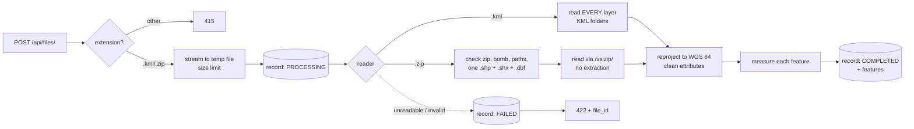

# Geospatial File Measurement API

A FastAPI service that accepts a **KML file** or a **zipped Shapefile**, reads every feature, and
returns its **area** (polygons) or **length** (lines) in metres. Each feature also reports its index,
geometry type, geometry, CRS and attributes.

Every measurement is made in a **projected CRS centred on that feature**: equal-area for areas,
equidistant for lengths. Against Karney's geodesic reference the result is within
**3 parts per billion**. The same areas measured in UTM are off by 565–1,650 ppm, and in Web Mercator
by up to 300 % ([benchmark](#1-a-local-projection-per-feature-not-utm)).

```
POST /api/files/                      upload + process a .kml or .zip
GET  /api/files/{id}/                 file information
GET  /api/files/{id}/measurements/    per-feature measurements (paginated) + totals
```

---

## Quick start

Requires **Python 3.12+**. Developed and tested on Python 3.13 / Windows 11. GDAL and PROJ come
bundled inside the `pyogrio` and `pyproj` wheels, so there is nothing to install system-wide.

```bash
python -m venv .venv
.venv\Scripts\activate            # Windows
# source .venv/bin/activate       # macOS / Linux
pip install -r requirements.txt

uvicorn app.main:create_app --factory --reload
```

Open **http://127.0.0.1:8000/docs** for interactive Swagger docs. `/` redirects there.

Ready-made files to upload are in [`samples/`](samples). Regenerate them with `python -m scripts.make_samples`.

| File | What it shows |
|---|---|
| `bengaluru_survey.kml` | Two KML folders: polygon, self-intersecting polygon (repaired), line, point, mixed MultiGeometry, placemark with no geometry |
| `bengaluru_parcels_wgs84.zip` | Shapefile in EPSG:4326 with a Polygon and a MultiPolygon |
| `bengaluru_roads_utm43n.zip` | Shapefile in **UTM zone 43N (EPSG:32643)**, reprojected and still measured exactly |
| `parcels_without_prj.zip` | Shapefile with **no `.prj`**: CRS unknown, fixable with the `source_crs` field |

**Tests:** `pytest` runs 74 tests in about 2 s.
**Accuracy benchmark:** `python -m scripts.benchmark_projections`

Configuration uses environment variables with the `GEO_` prefix ([`app/config.py`](app/config.py)):
`GEO_DATABASE_URL` (default `sqlite:///./data/geofiles.db`), `GEO_MAX_UPLOAD_BYTES` (50 MB), and
`GEO_MAX_UNCOMPRESSED_BYTES` (500 MB, the zip-bomb guard).

---

## API

### `POST /api/files/`: upload and process

`multipart/form-data` fields:

| Field | Required | Description |
|---|---|---|
| `file` | yes | A `.kml` file, or a `.zip` containing exactly one Shapefile (`.shp`, `.shx`, `.dbf`, optionally `.prj`/`.cpg`) |
| `source_crs` | no | CRS to assume **only if the file declares none**, e.g. `EPSG:32643` for a shapefile missing its `.prj` |

```bash
curl -F "file=@samples/bengaluru_survey.kml" http://127.0.0.1:8000/api/files/
```

`201 Created`, with a `Location: /api/files/b532fa55dfa944a6abd1c47fe4727e4a/` header:

```json
{
  "id": "b532fa55dfa944a6abd1c47fe4727e4a",
  "filename": "bengaluru_survey.kml",
  "feature_count": 6,
  "crs": "EPSG:4326",
  "status": "COMPLETED",
  "error": null,
  "created_at": "2026-10-10T09:45:19.589469Z"
}
```

### `GET /api/files/{id}/`: file information

This returns the same body as above. `status` is `PROCESSING`, `COMPLETED` or `FAILED`. If it is
`FAILED`, `error` says why.

### `GET /api/files/{id}/measurements/?offset=0&limit=500`: measurements

`limit` defaults to 500, with a maximum of 5000. Example response, trimmed to two features:

```json
{
  "file_id": "b532fa55dfa944a6abd1c47fe4727e4a",
  "crs": "EPSG:4326",
  "feature_count": 6,
  "offset": 0,
  "limit": 500,
  "summary": {
    "total_area_m2": 1600141.083296813,
    "total_length_m": 4999.999960859119,
    "status_counts": { "MEASURED": 3, "NOT_REQUIRED": 1, "UNSUPPORTED_GEOMETRY": 1, "EMPTY_GEOMETRY": 1 }
  },
  "features": [
    {
      "feature_id": 0,
      "layer": "Fields",
      "geometry_type": "Polygon",
      "crs": "EPSG:4326",
      "geometry": { "type": "Polygon", "coordinates": [[[77.599208502, 12.976119518], [77.599208336, 12.967080399], "..."]] },
      "properties": { "Name": "north field", "owner": "Asha" },
      "measurement": {
        "status": "MEASURED",
        "kind": "area",
        "value": 999999.9259310648,
        "unit": "m2",
        "projection": "+proj=laea +lat_0=12.971600 +lon_0=77.594600 +ellps=WGS84 +units=m",
        "note": null
      }
    },
    {
      "feature_id": 3,
      "layer": "Assets",
      "geometry_type": "Point",
      "crs": "EPSG:4326",
      "geometry": { "type": "Point", "coordinates": [77.5946, 12.9716] },
      "properties": { "Name": "well" },
      "measurement": { "status": "NOT_REQUIRED", "kind": null, "value": null, "unit": null, "projection": null, "note": "Point features have no area or length." }
    }
  ]
}
```

- `geometry` is **GeoJSON in WGS 84** (RFC 7946 §4 allows no other CRS). `crs` is the CRS the file declared.
- `projection` is the exact PROJ definition the value was computed in, so you can paste it into QGIS
  as a custom CRS and reproduce the number.

Every feature gets one measurement `status`. Nothing crashes on unexpected data:

| `status` | Meaning |
|---|---|
| `MEASURED` | `value` holds an area in m² (Polygon/MultiPolygon) or a length in m (LineString/MultiLineString) |
| `NOT_REQUIRED` | Point/MultiPoint, which has no area or length |
| `UNSUPPORTED_GEOMETRY` | e.g. a `GeometryCollection` (a KML MultiGeometry mixing points and lines) |
| `EMPTY_GEOMETRY` | The feature has no geometry, such as a KML placemark with only a name |
| `UNKNOWN_CRS` | The file declares no CRS. Upload again with `source_crs` |
| `INVALID_COORDINATES` | The coordinates are not valid longitude/latitude, usually because a wrong `source_crs` was given. If reprojection produced infinite coordinates, `geometry` is `null`, since JSON cannot hold infinity |
| `FAILED` | A geometry the libraries could not process. Logged, and the other features are unaffected |

### Errors: RFC 9457 Problem Details

Every error is returned as `application/problem+json`:

```json
{
  "type": "about:blank",
  "title": "Unprocessable Content",
  "status": 422,
  "detail": "The upload is not a valid zip archive.",
  "instance": "/api/files/",
  "file_id": "2117b32f8192491ebc08a45b8afe7383"
}
```

| Status | When |
|---|---|
| 400 | Empty upload |
| 404 | Unknown file id |
| 409 | Measurements requested for a file that is not `COMPLETED` |
| 413 | Upload larger than `GEO_MAX_UPLOAD_BYTES` |
| 415 | Extension other than `.kml` / `.zip` |
| 422 | Content could not be processed: broken zip, missing `.shp`/`.shx`/`.dbf`, zip-bomb signature, unreadable file, a CRS that cannot be converted to WGS 84 (e.g. a local engineering grid), or an invalid `source_crs`. When a record was created, `file_id` points to it (status `FAILED`, with the reason) |

---

## Architecture

```
app/
├── main.py          App factory: wires settings, database, routes, error handler
├── api.py           HTTP routes + the ONE place domain errors become HTTP responses
├── schemas.py       Response bodies (Pydantic)
├── service.py       Facade: validate → read → measure → store
├── repository.py    All database access (SQLAlchemy)
├── models.py        Tables: geo_files, features
├── db.py            Engine/session setup
├── domain.py        Core types: enums, Measurement value object, ParsedFeature
├── errors.py        Domain exception hierarchy
├── config.py        Settings (env vars, limits)
└── geo/             Pure geospatial logic, no web or database code
    ├── archive.py       Safe zip inspection (zip-bomb and path checks, shapefile parts)
    ├── readers.py       KML / zipped-Shapefile readers (GDAL via pyogrio) + factory
    ├── crs.py           CRS parsing and labels
    ├── projection.py    Local projections + geodesic edge densification
    └── measurement.py   Per-geometry-type measurers
scripts/   make_samples.py, benchmark_projections.py
tests/     74 tests + sample_data.py (builders shared with scripts/)
```

Dependencies point inward. `geo/` knows nothing about HTTP or SQL, `service.py` knows nothing
about HTTP, and only `api.py` knows HTTP status codes.

### File-processing flow



1. **Cheap checks first.** The extension and an optional `source_crs` are validated before any
   bytes are stored.
2. The upload is streamed to a temp file with a **server-generated name** (OWASP) and an upload
   size limit.
3. A file record is created (`PROCESSING`). From here on, any failure is recorded as `FAILED` with
   a reason. A context manager in the service does this, so no code path can leave a record stuck.
4. A **reader** is chosen by extension:
   - **KML** is read with GDAL's LIBKML driver. Each `<Folder>` is a separate layer, and GDAL reads
     only the first one by default, so every layer is read explicitly. Styling fields GDAL invents
     (`tessellate`, `extrude`, …) are dropped.
   - **Zipped Shapefile**: the archive is inspected, then GDAL reads it straight from the zip
     (`/vsizip/`) without extracting anything.
5. Geometries are **reprojected to WGS 84** on the way in, and attributes are made JSON-safe
   (`NaN`/`NaT` dropped, dates in ISO 8601).
6. Each feature is measured, and the features and measurements are stored in one commit.

### Measurement flow

```
feature ──► no geometry? ─────────────► EMPTY_GEOMETRY
        ──► no CRS? ──────────────────► UNKNOWN_CRS
        ──► not valid lon/lat? ───────► INVALID_COORDINATES
        ──► look up measurer by geometry type
              Polygon, MultiPolygon        → AREA
              LineString, MultiLineString  → LENGTH
              Point, MultiPoint            → NOT_REQUIRED
              anything else                → UNSUPPORTED_GEOMETRY
AREA / LENGTH:
  1. repair if invalid           shapely.make_valid (a self-intersecting "bowtie" otherwise measures 0)
  2. centre = feature centroid
  3. densify long edges along the geodesic (vertices every ≤ 1 km)
  4. project into a local CRS centred there
        AREA   → Lambert Azimuthal Equal-Area   (+proj=laea)
        LENGTH → Azimuthal Equidistant          (+proj=aeqd)
  5. planar .area / .length in metres
```

### CRS handling

| Input | What happens |
|---|---|
| KML | Always WGS 84 longitude/latitude (OGC KML 2.2). GDAL reports EPSG:4326 |
| Shapefile with `.prj` | The `.prj` is parsed and labelled by authority code (`EPSG:32643`), or by name if it has no code |
| Shapefile without `.prj` | The 1998 ESRI spec does not require a `.prj`, so its absence is legal. **No guessing**: `crs` is `null` and features are `UNKNOWN_CRS` until the client supplies `source_crs` |
| Wrong `source_crs` | Caught by a coordinate-range check (`INVALID_COORDINATES`) instead of producing silent nonsense |
| CRS with no link to the Earth (engineering/site grid) | Cannot be converted to WGS 84, so the file is `FAILED` with a clear 422 |

All geometry is stored and returned in WGS 84. Measurement never happens in degrees, and never in the
file's own grid either. Every feature is projected into its own local CRS, as explained below.

---

## Design decisions

### 1. A local projection per feature, not UTM

Measuring in degrees is meaningless, because a degree of longitude shrinks from about 111 km at the
equator to 0 km at the poles. The usual alternatives are:

- **Web Mercator** (EPSG:3857, the web-map CRS) inflates area by sec²(latitude).
- **UTM** is conformal, with a scale factor of 0.9996 on the central meridian. Areas come out
  0.08 % too small there and grow too large toward the zone edges. Yildirim & Kaya (2008) measured
  about 8,000 m² of UTM error on a 1,000 ha parcel and recommended equal-area projections for area work.

Projection Wizard (Šavrič et al. 2016, built on Snyder's guidelines) frames projection choice as
**pick the property to preserve, then centre on the area of interest**. That is what this service
does per feature: **Lambert Azimuthal Equal-Area** for area, which preserves area exactly, and
**Azimuthal Equidistant** for length. The AEQD scale error is about (r/R)²/6 at distance r from the
centre, which is about 1 ppm at 15 km. A transverse Mercator at the same distance is 3× worse.

Results from `python -m scripts.benchmark_projections` (relative area error vs Karney's geodesic
algorithm; ppm = parts per million):

| Site | Web Mercator | UTM zone | **This service** |
|---|---|---|---|
| Bengaluru (2.6° from UTM 43N's central meridian) | +59,441 ppm | +1,161 ppm | **−0.003 ppm** |
| On a UTM central meridian (75°E) | +59,441 ppm | −800 ppm | **−0.003 ppm** |
| Near a UTM zone edge (77.9°E) | +59,441 ppm | +1,650 ppm | **−0.003 ppm** |
| Oslo (60°N) | +2,965,100 ppm | −565 ppm | **−0.003 ppm** |

Squares of 1 km and 100 km give the same figures. The tests assert agreement within **1 ppm** for
squares from 10 m to 100 km, for 1 km squares at the equator, 35°S and 60°N, and for holes,
multipolygons, and straight and bent lines.

*Alternatives considered:*
- **UTM via `estimate_utm_crs`.** Standard EPSG codes and simple, but 0.06–0.17 % error, and it
  breaks for features spanning zones.
- **One equal-area CRS for the whole file** (e.g. EPSG:6933). Equal-area, but lengths would be
  distorted, and the file's extent is unbounded.
- **Pure geodesic computation.** The most accurate option, but the brief explicitly asks to
  transform to a projected CRS. It is used here as the **test oracle** instead.

### 2. Polygon edges follow geodesics

An edge between two vertices is ambiguous: is it straight in degrees, straight in some projection,
or the shortest path on the Earth? This service uses the **geodesic**, the shortest path. That is
the reading PostGIS `geography` uses (edges are shortest paths, area on the spheroid via
GeographicLib), and it matches QGIS ellipsoidal measurement, which also uses GeographicLib.
Edges longer than 1 km are densified along their geodesic before projecting.

This was found empirically. With and without densification, the error against the geodesic area was:

| Square | Straight edges | Geodesic edges |
|---|---|---|
| 1 km | −3×10⁻⁹ | −3×10⁻¹¹ |
| 20 km | −1.2×10⁻⁶ | −3×10⁻¹¹ |
| 100 km | −3.1×10⁻⁵ | −3×10⁻¹¹ |

So PROJ's ellipsoidal LAEA is exactly equal-area. The small leftover gap came only from the edge
definition.

### 3. Repair invalid polygons instead of rejecting them

Real data contains self-intersecting rings. Ledoux et al. (2014) show that automatic repair is
practical and necessary. Without repair the error is silent: a bowtie polygon's two lobes cancel
and **measure 0 m²**. The service applies `shapely.make_valid` (GEOS) and says so in the
measurement's `note`.

### 4. Reading zips safely

- **Nothing is extracted to disk.** GDAL reads members via `/vsizip/`, so zip-slip cannot write
  files. Entry names containing `..`, absolute paths or `:` are rejected anyway.
- **Zip bombs.** Following Fifield (2019, *A better zip bomb*, USENIX WOOT), the service rejects:
  - total declared size above a limit,
  - any entry claiming a ratio above **1032:1**, the DEFLATE maximum,
  - **overlapping entries**, the signature of the non-recursive bomb.

  The paper warns that checks outside the real parser are not a complete defence. In production,
  pair them with process memory and time limits.
- **Shapefile rules from the ESRI spec (1998):** the main file, index and dBASE table must share a
  name (`.shp`, `.shx`, `.dbf`), so missing parts are reported precisely. macOS `__MACOSX/` and `._*`
  files are ignored.
- **Other OWASP file-upload advice:** an extension allowlist (so `x.kml.exe` is rejected), size
  limits, server-generated file names, and no GDAL messages (which contain server paths) in
  responses.

### 5. Synchronous processing

The brief describes `POST` as "uploads and processes a file". Measurement runs at about **4,700
features/s** on a laptop, so typical survey files finish in well under a second, and synchronous
processing keeps the system simple. The `status` field and the `PROCESSING → COMPLETED/FAILED`
lifecycle are already in the API. Moving to a background worker (Celery/RQ/arq) would change
`201` to `202 Accepted` and nothing else in the contract.

A profiling note: building a pyproj `Transformer` with `from_crs` was 73 % of the runtime because
of PROJ's operation search. Using an explicit pipeline (`unitconvert` → `laea`) is 6× faster to
build and gives bit-identical coordinates, which made measurement 4× faster overall.

### 6. Storage: SQLite + JSON columns

There is zero setup for reviewers. Geometry is stored as GeoJSON and attributes as JSON. The six
measurement columns map to one `Measurement` value object through a SQLAlchemy `composite`. Swapping
in PostgreSQL only needs `GEO_DATABASE_URL`. **PostGIS** would be the next step for spatial queries.

### 7. Errors

Domain code raises exceptions from `errors.py` and knows nothing about HTTP. `api.py` maps exception
classes to status codes in one dictionary and renders RFC 9457 Problem Details.

---

## Code design (refactoring.guru)

The code follows [refactoring.guru](https://refactoring.guru) principles. A pattern is used only
where it removes a concrete smell. "Clean code contains a minimal number of classes" is one of the
site's own criteria, so speculative structure was left out.

| Principle / pattern | Where | Smell it removes |
|---|---|---|
| **Strategy** (configured with functions, as the site suggests for modern languages) | `geo/measurement.py`: `AREA` / `LENGTH` are one `ProjectedMeasurer` class configured with a projection and a quantity | *Switch Statements* on geometry type; *Duplicate Code* between area and length |
| **Null Object** | `NoMeasurement` for points and unsupported types | Scattered `None`/type checks |
| **Factory Method** (registry form) | `geo/readers.py`: `reader_for()` / `READER_FACTORIES` | Type conditionals at call sites. A lookup inside a factory is the site's stated exception to *Switch Statements* |
| **Adapter** | `geo/readers.py` turns GDAL/GeoPandas output into `ParsedDataset` | Library types leaking through the app |
| **Facade** | `service.FileProcessingService` | The API coordinating readers, measurers and the ORM itself. Kept thin to avoid a god object |
| Replace Error Code with Exception | `errors.py`, mapped once in `api.py` | Error codes and HTTP knowledge in domain code |
| Replace Type Code with Class | `StrEnum`s in `domain.py` | *Primitive Obsession* (status strings) |
| Replace Data Value with Object | `Measurement` value object + ORM `composite` | *Data Clumps* (six measurement fields travelling together) |
| Introduce Foreign Method | `projection.follow_geodesics` | *Incomplete Library Class*: shapely geometries can't be given new methods |
| Replace Nested Conditional with Guard Clauses | `measurement.measure_feature` | Nested if/else |
| Replace Magic Number with Symbolic Constant | `DEFLATE_MAX_COMPRESSION_RATIO`, `MAX_EDGE_M`, `MAX_LATITUDE`, … | Unexplained numbers |
| Extract Method | `repository.summary`, `api._status_for` | *Long Method* |
| Avoided: Template Method | The readers share helper functions, not a base class | Inheritance for two readers would be *Speculative Generality* |

---

## Testing

74 tests (`pytest`):

- **Measurement accuracy** (`test_measurement.py`). Shapes are generated with geodesic steps, and
  results are compared with **Karney's algorithm**, an independent reference accurate to about 15 nm.
  The tests cover sizes from 10 m to 100 km, latitudes up to 60°, holes, multipolygons, bent lines,
  invalid polygons, and every non-measured status.
- **Projection** (`test_projection.py`). Geodesic densification, and that the fast pipeline
  transform equals pyproj's CRS-to-CRS transform.
- **Archive safety** (`test_archive.py`). No `.shp`, several `.shp`, missing `.shx`/`.dbf`, size
  limit, forged ratio, overlapping entries, path traversal, macOS junk.
- **Readers** (`test_readers.py`). Every KML folder is read, attributes are cleaned, a UTM shapefile
  is reprojected, a missing `.prj` is handled, and the fallback CRS applies only when the file has none.
- **API end to end** (`test_api.py`). All endpoints, pagination, totals, a projected input, the
  `.prj` workflow, a wrong `source_crs`, coordinates that reproject to infinity, an engineering CRS,
  an empty KML, corrupt files, FAILED records, and the RFC 9457 format.

---

## Learnings

I started this assignment with no GIS background. Things I learned:

- **Coordinates are meaningless without their CRS.** The same pair of numbers can be degrees or
  metres. Measuring in degrees, or in Web Mercator, is a classic silent error. My benchmark showed
  +297 % area at 60°N.
- **Every projection distorts something.** The choice follows from what you measure: equal-area
  for area, equidistant for distance. UTM is a good general grid but a poor area-measuring tool.
- **"Accurate" needs a reference.** Using Karney's geodesic algorithm as a test oracle turned
  vague claims into numbers. It also exposed a subtle issue: the remaining error was not
  projection distortion but the *definition of a polygon edge*.
- **File formats have sharp edges.** KML folders become separate GDAL layers, and only the first is
  read by default. A Shapefile holds one geometry type and may have no `.prj`. A self-intersecting
  polygon can measure 0 m².
- **Profile before optimising.** The slow part was building transformers, not the geometry maths.
- Reading the primary sources (papers, specs, RFCs) changed the design more than any tutorial.

## Future scope

- **Background processing** for very large files (a worker queue, `202 Accepted`, progress in `status`).
- **PostGIS** storage with spatial indexes, plus endpoints such as "features within a bounding box".
- **More formats:** KMZ, GeoJSON, GeoPackage, and zips holding several shapefiles (as layers).
- **Antimeridian-crossing features** (the centroid of a feature spanning ±180° is computed wrongly today).
- **Perimeter for polygons**, and **3D (terrain-following) length** using KML altitudes.
- **Authentication, rate limiting, and an upload cap at the reverse proxy.** Today the size limit
  applies after Starlette has spooled the body.
- **Alembic migrations, Docker image, CI pipeline.**

---

## References

1. Karney, C. F. F. (2013). Algorithms for geodesics. *Journal of Geodesy*, 87(1), 43–55. https://doi.org/10.1007/s00190-012-0578-z
2. Yildirim, F., & Kaya, A. (2008). Selecting map projections in minimizing area distortions in GIS applications. *Sensors*, 8(12), 7809–7817. https://pmc.ncbi.nlm.nih.gov/articles/PMC3790990/
3. Šavrič, B., Jenny, B., & Jenny, H. (2016). Projection Wizard – An online map projection selection tool. *The Cartographic Journal*, 53(2), 177–185. https://projectionwizard.org (selection rules after Snyder, J. P., 1987, *Map Projections: A Working Manual*, USGS PP 1395)
4. Ledoux, H., Arroyo Ohori, K., & Meijers, M. (2014). A triangulation-based approach to automatically repair GIS polygons. *Computers & Geosciences*, 66, 121–131.
5. Fifield, D. (2019). A better zip bomb. *13th USENIX Workshop on Offensive Technologies (WOOT '19)*. https://www.usenix.org/conference/woot19/presentation/fifield
6. ESRI (1998). *ESRI Shapefile Technical Description*. ESRI White Paper.
7. Open Geospatial Consortium (2008). *OGC KML 2.2*.
8. IETF RFC 7946 (2016). *The GeoJSON Format*. https://datatracker.ietf.org/doc/rfc7946/
9. IETF RFC 9457 (2023). *Problem Details for HTTP APIs*. https://www.rfc-editor.org/rfc/rfc9457
10. PROJ: geodesic calculations (Karney's algorithms). https://proj.org/en/stable/geodesic.html
11. OWASP. *File Upload Cheat Sheet*. https://cheatsheetseries.owasp.org/cheatsheets/File_Upload_Cheat_Sheet.html
12. PostGIS FAQ: geography "inside" (edges as shortest paths) and `ST_Area` (spheroid via GeographicLib). https://postgis.net/documentation/faq/geography-inside/, https://postgis.net/docs/ST_Area.html
13. QGIS API: `QgsDistanceArea` (GeographicLib for ellipsoidal calculations). https://api.qgis.org/api/classQgsDistanceArea.html
14. Shvets, A. *Refactoring.Guru*. https://refactoring.guru
